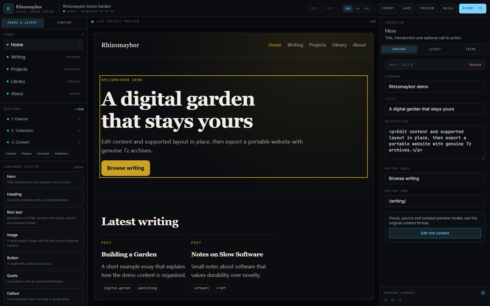

# Rhizomaybor

**A reusable, constrained visual editor and static website builder for digital gardens and personal sites.**

Rhizomaybor lets people maintain a supported website structure without treating the rendered page as source code. Content, layout, theme and publication state live in one versioned project model shared by the online editor, the desktop shell and the standalone website generator.

- **Online editor:** static application at `/editor/`, deployable to GitHub Pages.
- **Desktop editor:** Tauri 2 shell for opening and saving a local project directory.
- **MarkText-style content editing:** direct rendered editing through Muya, plus source and isolated preview modes.
- **Constrained visual layout:** registered components, permitted containers, drag-and-drop ordering, theme controls and responsive previews.
- **Genuine 7z export:** real 7-Zip archives created with 7-Zip 24.09 compiled to WebAssembly.
- **Publication boundary:** the deployable website archive contains only approved public pages, sections, documents and assets.

Rhizomaybor is not an unrestricted HTML/CSS IDE, drag-anywhere website canvas, SaaS CMS or hosted publishing service. It is a guided editing layer for websites that fit its component model.



## Status

The current line is **v0.5.0**. The online editor, shared project model, standalone site builder and 7z export path are covered by automated browser and Node tests. Desktop source and packaging are included; see the test report and release notes in this repository for the exact verification state of the current commit.

The application does not require an account, database, backend or cloud service.

## Who this is for

Rhizomaybor is designed for:

- personal website owners who want to maintain writing, projects, notes and about pages without editing source files for every change;
- digital-garden authors who want a stable content and publication model;
- template authors who can define supported pages, sections, components and themes;
- developers who need a portable static export rather than a hosted CMS lock-in.

It is not designed for arbitrary page-building, unrestricted script editing or multi-user cloud collaboration.

## What visual editing can change

The editor can change supported model data:

- page titles, descriptions and publication status;
- navigation labels and links;
- registered components and their supported properties;
- the order of components within a permitted section;
- card order inside a card grid;
- section layout and variant from the registry;
- typography, colors, spacing, corners and content width from bounded theme options;
- Markdown, MDX and HTML content documents;
- local project assets and their publication status.

The editor does **not** convert the persistent project into arbitrary DOM mutations. It also does not let unsupported components or layouts enter a section that does not permit them.

## Online and desktop modes

### Online editor

Run locally:

```bash
npm install
npm run dev
```

Open `http://localhost:3000/editor/`.

The online editor:

- imports a `.json` project or a `.7z` project archive;
- stores autosave and recovery state in browser storage;
- downloads project JSON and genuine `.7z` archives;
- never writes directly to a GitHub repository;
- does not embed a GitHub token or publishing secret.

GitHub Pages deployment is handled by [`.github/workflows/pages.yml`](.github/workflows/pages.yml). The build uses the `/rhizomaybor` subpath and is exercised by Playwright.

### Desktop editor

The desktop edition reuses the same React editor and project model through a Tauri 2 shell. It adds local directory selection, direct project saves and writing generated site files to disk.

```bash
npm run desktop:dev
npm run desktop:build
```

Windows 11 is the primary packaging target. The desktop build uses the system WebView2 runtime. See [docs/desktop.md](docs/desktop.md).

## Supported content formats

Project content documents have an explicit format:

| Format | Visual editing | Source editing | Notes |
| --- | --- | --- | --- |
| Markdown | Muya visual engine | Yes | GFM tables, lists, links, images and standard formatting |
| MDX | Muya visual engine | Yes | MDX component syntax is preserved in source but is not executed by the standalone export |
| HTML | HTML-aware contentEditable | Yes | Unknown safe elements and attributes are retained wherever the sanitizer permits them |

For HTML, Rhizomaybor analyzes the source before opening visual mode. Unknown structures are reported and source mode remains available. Content is never silently converted from HTML to Markdown.

Previewing untrusted HTML uses a sandboxed, script-free document. Scripts and event-handler attributes are removed from rendered output while the original project source remains available in source mode.

## One shared project model

The canonical model is a `SiteProject` JSON document with versioned schemas for:

- `SiteProject`
- `SiteConfig`
- `Page`
- `Section`
- `Component`
- `ComponentProperty`
- `Theme`
- `Navigation`
- `ContentDocument`
- `Asset`
- `PublicationStatus`
- `ExportManifest`

The rendered DOM is never the source of truth. See [docs/project-schema.md](docs/project-schema.md) and [docs/architecture.md](docs/architecture.md).

The editor includes:

- stable identifiers;
- undo and redo;
- autosave;
- dirty-state tracking;
- recovery after interrupted editing;
- import validation;
- explicit schema migration;
- change summaries;
- validation before export.

Unknown project, component and property fields use open object schemas so a newer editor can preserve information it does not yet understand.

## Create or import a project

Generate the example project from the legacy example content:

```bash
npm run project:migrate
```

Include draft and private records in a local migration when needed:

```bash
npm run project:migrate -- --include-unpublished
```

Validate it:

```bash
npm run project:validate
```

In the online editor, use **Import** for a project JSON file or a project `.7z` archive. In the desktop editor, choose a project directory containing `.rhizomaybor/project.json` or `rhizomaybor.project.json`.

## Build a standalone website

```bash
npm run build:project -- --project examples/project/rhizomaybor.project.json --output out-project
node scripts/serve-static.mjs out-project 4174
```

Open `http://127.0.0.1:4174/`.

The generated site contains its own HTML, CSS and local runtime files. It does not require Rhizomaybor, Next.js or a server application in production.

MDX components are intentionally not executed in the standalone builder. Use the source editor to inspect or translate unsupported MDX into supported static HTML before website export.

## Export and import

### Editable project archive

```bash
npm run export:project
```

The editable archive contains:

- `rhizomaybor.project.json`
- original publication states
- original Markdown, MDX and HTML source
- embedded assets
- `export-manifest.json`
- file sizes and SHA-256 checksums

### Publishable website archive

```bash
npm run export:website
```

The public archive contains only:

- published pages;
- published sections;
- published content documents;
- published assets;
- generated static files;
- the export manifest.

Draft and private pages, sections, documents and assets are listed as excluded in the manifest and are not emitted.

Both modes use the actual 7z container format. The file signature is verified in tests, and archives are extracted with an independently installed 7-Zip binary.

## Privacy and publication boundaries

The public website build:

1. accepts only `published/` content from the legacy content contract;
2. requires frontmatter status to agree with the directory;
3. excludes draft and private project records;
4. removes admin and API routes from the public static build;
5. audits the generated artifact for private canaries, secrets, local paths, source maps and forbidden routes.

Do not put secrets in `NEXT_PUBLIC_*` variables. They are compiled into client-visible output.

GitHub Pages cannot write arbitrary changes back to a repository. Rhizomaybor therefore uses explicit local import/export and never pretends the static editor has repository write access.

## Development

Requirements:

- Node.js 22
- npm 10+
- Rust and Cargo for desktop builds
- WebView2 on Windows
- an independently installed 7z-compatible extractor for the archive round-trip test

```bash
npm ci
npm run typecheck
npm test
npm run test:e2e:install
npm run build:example
npm run build:pages
npm run build:example
npm run test:e2e
```

The last `build:example` restores the root-path static output after the subpath build.

Useful commands:

```bash
npm run dev
npm run test:unit
npm run test:e2e
npm run project:validate
npm run build:project
npm run export:project
npm run export:website
npm run verify:7z -- <archive.7z> <project|website>
npm run desktop:test
npm run desktop:build
```

## Project structure

```text
app/editor/                 Online editor route
components/editor/          Shared visual editor UI
lib/project/                Schema, migrations, editor state, rendering, export
examples/project/           Generated example SiteProject
scripts/                    Migration, validation, build, archive and test servers
src-tauri/                  Desktop shell and filesystem commands
tests/unit/                 Schema, editor, HTML, autosave, publication and 7z tests
tests/e2e/                  Playwright browser workflows
docs/                       Architecture, migration, desktop, export and user guides
```

The original Markdown/MDX website remains supported through the legacy content contract and publication gate.

## Documentation

- [Architecture](docs/architecture.md)
- [Project schema](docs/project-schema.md)
- [User guide](docs/user-guide.md)
- [Migration guide](docs/migration.md)
- [Desktop guide](docs/desktop.md)
- [Export format](docs/export-format.md)
- [MarkText and Muya integration](docs/marktext-integration.md)
- [Legacy content schema](docs/content-schema.md)
- [Security model](docs/security-model.md)
- [Third-party notices](docs/third-party-notices.md)
- [Test report](docs/test-report.md)
- [v0.5.0 release notes](docs/release-v0.5.0.md)

## Known limitations

- The standalone website generator does not execute MDX components.
- The visual component set is intentionally smaller than arbitrary HTML/CSS.
- Unsupported HTML structures use source editing rather than promising perfect visual fidelity.
- The online editor cannot save directly into a Git repository.
- Desktop installers are currently unsigned unless a code-signing environment is supplied.
- The GitHub Pages deployment requires the repository Pages environment to permit Actions deployments.
- A release candidate is appropriate if desktop packaging or any required external deployment check remains unverified.

## License

Rhizomaybor is licensed under the Mozilla Public License 2.0. User-provided content and assets are not automatically relicensed by being edited or exported with Rhizomaybor. Third-party components retain their own licenses; see [docs/third-party-notices.md](docs/third-party-notices.md).
