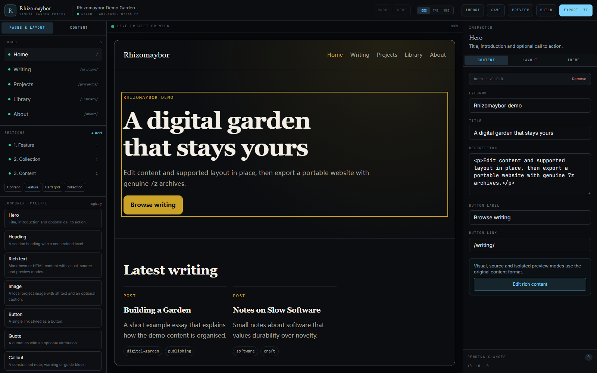

# Rhizomaybor

**面向数字花园与个人网站的可复用、受约束可视化编辑器和静态网站构建器。**

Rhizomaybor 让人无需把渲染后的 DOM 当作源代码，也能维护受支持的网站结构。内容、布局、主题和发布状态统一保存在版本化项目模型中，并由在线编辑器、桌面端外壳和独立静态网站生成器共享。

- **在线编辑器：** 部署在 `/editor/` 的静态应用，可发布到 GitHub Pages。
- **桌面编辑器：** 基于 Tauri 2，可打开和保存本地项目目录。
- **MarkText 风格内容编辑：** 通过 Muya 直接编辑渲染内容，并提供源码与隔离预览模式。
- **受约束的可视化布局：** 注册组件、允许的容器、拖放排序、主题控制和响应式预览。
- **真正的 7z 导出：** 使用 7-Zip 24.09 的 WebAssembly 版本创建真实 7z 归档。
- **发布边界：** 可发布网站归档只包含已批准公开的页面、区块、文档和资源。

Rhizomaybor 不是无限制的 HTML/CSS IDE、任意拖放的建站画布、SaaS CMS 或托管发布服务。它是用于符合组件模型的网站的受引导编辑层。



## 当前状态

当前版本线为 **v0.5.0**。在线编辑器、共享项目模型、独立网站构建器和 7z 导出路径均有自动化浏览器与 Node 测试覆盖。仓库包含桌面端源码和打包流程；请以测试报告和 Release 说明中的实际验证状态为准。

应用不需要账户、数据库、后端或云服务。

## 适用对象

Rhizomaybor 适用于：

- 希望在不必每次编辑源码的情况下维护写作、项目、笔记和关于页面的个人网站所有者；
- 需要稳定内容与发布模型的数字花园作者；
- 定义受支持页面、区块、组件和主题的模板作者；
- 需要可移植静态导出而不希望被托管 CMS 锁定的开发者。

它不适用于任意建站、脚本编辑或多用户云端协作。

## 可视化编辑能修改什么

编辑器可以修改受支持的模型数据：

- 页面标题、描述和发布状态；
- 导航标签和链接；
- 注册组件及其受支持属性；
- 允许区块内的组件顺序；
- 卡片网格中的卡片顺序；
- 注册表中的区块布局与变体；
- 有边界的字体、颜色、间距、圆角和内容宽度；
- Markdown、MDX 和 HTML 内容文档；
- 本地项目资源及其发布状态。

编辑器不会把渲染后的 DOM 任意改写为持久状态，也不会让不支持的组件或布局进入不允许它的区块。

## 在线与桌面模式

### 在线编辑器

```bash
npm install
npm run dev
```

打开 `http://localhost:3000/editor/`。

已验证的公开部署地址：[styayur.github.io/rhizomaybor/editor](https://styayur.github.io/rhizomaybor/editor/)。

在线编辑器支持：

- 导入 `.json` 项目或 `.7z` 项目归档；
- 在浏览器中自动保存和恢复中断编辑；
- 下载项目 JSON 和真正的 `.7z` 归档；
- **不会**直接写入 GitHub 仓库；
- 前端不包含 GitHub Token 或发布密钥。

GitHub Pages 部署由 [`.github/workflows/pages.yml`](.github/workflows/pages.yml) 处理。构建使用 `/rhizomaybor` 子路径，并由 Playwright 实际验证。

### 桌面编辑器

桌面版通过 Tauri 2 复用同一套 React 编辑器和项目模型，并增加本地目录选择、直接保存项目和写入生成站点文件的能力。

```bash
npm run desktop:dev
npm run desktop:build
```

主要打包目标是 Windows 11，使用系统 WebView2 运行时。详见 [docs/desktop.md](docs/desktop.md)。

## 支持的内容格式

| 格式 | 可视化编辑 | 源码编辑 | 说明 |
| --- | --- | --- | --- |
| Markdown | Muya 可视化引擎 | 支持 | GFM 表格、列表、链接、图片和标准格式 |
| MDX | Muya 可视化引擎 | 支持 | 保留 MDX 组件源码；独立导出不执行 MDX 组件 |
| HTML | HTML 感知的 contentEditable | 支持 | 在安全策略允许时保留未知元素和属性 |

打开 HTML 可视化模式前，编辑器会分析源码并提示未知结构。源码模式始终可用。内容不会被静默从 HTML 转成 Markdown。

预览不可信 HTML 时使用禁用脚本的沙箱文档。渲染输出会移除脚本和事件属性，而原始项目源码仍保存在源码模式中。

## 共享项目模型

规范模型是一份 `SiteProject` JSON，包含以下版本化模式：

- `SiteProject`
- `SiteConfig`
- `Page`
- `Section`
- `Component`
- `ComponentProperty`
- `Theme`
- `Navigation`
- `ContentDocument`
- `Asset`
- `PublicationStatus`
- `ExportManifest`

渲染后的 DOM 不是事实来源。详见 [docs/project-schema.md](docs/project-schema.md) 与 [docs/architecture.md](docs/architecture.md)。

编辑器提供稳定 ID、撤销/重做、自动保存、脏状态、恢复、导入验证、显式迁移、变更摘要和导出前验证。未知项目、组件和属性字段通过开放对象模式保留。

## 创建或导入项目

从旧版示例内容生成项目：

```bash
npm run project:migrate
```

如需在本地迁移草稿和私有记录：

```bash
npm run project:migrate -- --include-unpublished
```

验证项目：

```bash
npm run project:validate
```

在线编辑器通过 **Import** 导入项目 JSON 或项目 `.7z` 归档。桌面编辑器可打开包含 `.rhizomaybor/project.json` 或 `rhizomaybor.project.json` 的项目目录。

## 构建独立网站

```bash
npm run build:project -- --project examples/project/rhizomaybor.project.json --output out-project
node scripts/serve-static.mjs out-project 4174
```

打开 `http://127.0.0.1:4174/`。

生成站点包含自己的 HTML、CSS 和本地运行文件，不依赖 Rhizomaybor、Next.js 或生产服务器应用。独立构建不执行 MDX 组件；导出前可用源码模式检查并转换为受支持的静态 HTML。

## 导出与导入

### 可编辑项目归档

```bash
npm run export:project
```

包含：

- `rhizomaybor.project.json`
- 原始发布状态
- 原始 Markdown、MDX 与 HTML 源码
- 内嵌资源
- `export-manifest.json`
- 文件大小与 SHA-256 校验和

### 可发布网站归档

```bash
npm run export:website
```

只包含：

- 已发布页面；
- 已发布区块；
- 已发布内容文档；
- 已发布资源；
- 生成的静态文件；
- 导出清单。

草稿和私有页面、区块、文档、资源只会在清单中记录为排除项，不会进入归档。

两种模式都使用真实 7z 容器格式。测试会检查文件签名，并使用独立安装的 7-Zip 程序解压验证。

## 隐私与发布边界

公开网站构建会：

1. 只接受旧内容契约中的 `published/`；
2. 要求 frontmatter 状态与目录一致；
3. 排除草稿和私有项目记录；
4. 从公开静态产物中移除 admin 与 API 路由；
5. 扫描私有 canary、密钥、本地路径、source map 和禁止路由。

不要把秘密放入 `NEXT_PUBLIC_*` 环境变量，它们会进入客户端可见输出。

GitHub Pages 不能直接把任意修改写回仓库。Rhizomaybor 因此使用明确的本地导入/导出流程，不会假装静态编辑器拥有仓库写入权限。

## 开发

要求：

- Node.js 22
- npm 10+
- 桌面构建需要 Rust 与 Cargo
- Windows 需要 WebView2
- 7z 归档往返测试需要独立安装的 7z 兼容解压器

```bash
npm ci
npm run typecheck
npm test
npm run test:e2e:install
npm run build:example
npm run build:pages
npm run build:example
npm run test:e2e
```

最后一次 `build:example` 用于在子路径构建后恢复根路径静态产物。

常用命令：

```bash
npm run dev
npm run test:unit
npm run test:e2e
npm run project:validate
npm run build:project
npm run export:project
npm run export:website
npm run verify:7z -- <archive.7z> <project|website>
npm run desktop:test
npm run desktop:build
```

## 项目结构

```text
app/editor/                 在线编辑器路由
components/editor/          共享可视化编辑器界面
lib/project/                模式、迁移、编辑状态、渲染与导出
examples/project/           生成的示例 SiteProject
scripts/                    迁移、验证、构建、归档与测试服务器
src-tauri/                  桌面外壳与文件系统命令
tests/unit/                 模式、编辑器、HTML、自动保存、发布与 7z 测试
tests/e2e/                  Playwright 真实浏览器流程
docs/                       架构、迁移、桌面、导出与用户指南
```

原有 Markdown/MDX 网站继续通过旧内容契约和发布门禁运行。

## 文档

- [架构](docs/architecture.md)
- [项目模式](docs/project-schema.md)
- [用户指南](docs/user-guide.md)
- [迁移指南](docs/migration.md)
- [桌面指南](docs/desktop.md)
- [导出格式](docs/export-format.md)
- [MarkText 与 Muya 集成](docs/marktext-integration.md)
- [旧内容模式](docs/content-schema.md)
- [安全模型](docs/security-model.md)
- [第三方声明](docs/third-party-notices.md)
- [测试报告](docs/test-report.md)
- [v0.5.0 发布说明](docs/release-v0.5.0.md)

## 已知限制

- 独立网站生成器不执行 MDX 组件。
- 可视化组件集有意小于任意 HTML/CSS。
- 不支持的 HTML 结构使用源码编辑，不承诺完全视觉保真。
- 在线编辑器不能直接保存到 Git 仓库。
- 未提供代码签名环境时，桌面安装包未签名。
- GitHub Pages 部署需要仓库 Pages 环境允许 Actions 部署。
- 如果桌面打包或任何必要外部部署检查仍未验证，应发布准确的候选版本。

## 许可证

Rhizomaybor 使用 Mozilla Public License 2.0。用户内容与资源不会仅因经过 Rhizomaybor 编辑或导出而自动改用该许可证。第三方组件保留各自许可证，见 [docs/third-party-notices.md](docs/third-party-notices.md)。

